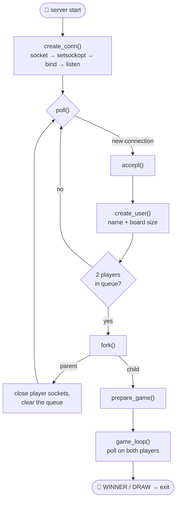
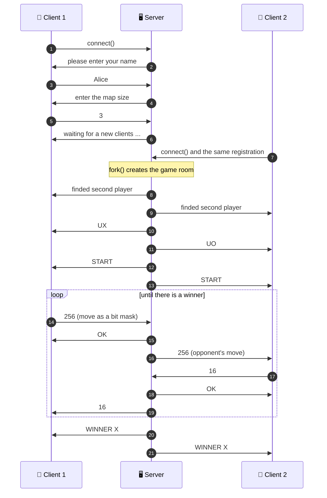

<div align="center">

# ❌ XO Game ⭕

### Networked Tic-Tac-Toe in pure C

A two-player client–server game over **TCP**. The server pairs players automatically<br>
and runs every match in its own process.


</div>

---

## 📑 Table of Contents

- [✨ Features](#-features)
- [🌐 Networking](#-networking)
- [🏗 Server Architecture](#-server-architecture)
- [📡 Protocol](#-protocol)
- [🧠 Game Logic: the Board as Bits](#-game-logic-the-board-as-bits)
- [📂 Project Structure](#-project-structure)
- [🚀 Build & Run](#-build--run)
- [🎮 How to Play](#-how-to-play)
- [🗺 Roadmap](#-roadmap)

---

## ✨ Features

| | |
|---|---|
| 🔌 **TCP server** | accepts any number of clients on port `8080` |
| 🤝 **Matchmaking** | the first two registered players are put into one room |
| 🍴 **One room = one process** | every match runs in its own process (`fork`), so matches don't interfere |
| 📦 **Custom protocol** | length-prefixed messages, so TCP can't glue them together |
| ⚡ **No threads** | `poll()` watches sockets and `stdin` in a single loop |
| 🧮 **Bitboard** | moves are stored as bit masks, checking a cell is a single `&` |
| 🛡 **Server-side checks** | the server checks whose turn it is and whether a cell is taken |

---

## 🌐 Networking

Everything is built on the **BSD Sockets API** (POSIX), no third-party libraries.

### What is used and where

| Technology | Where | Why |
|---|---|---|
| `socket(AF_INET, SOCK_STREAM, 0)` | `conn/ConnHandler.c`, `client/client.c` | a TCP socket over **IPv4** |
| `setsockopt(SO_REUSEADDR)` | `conn/ConnHandler.c` | the server can restart on the same port right away, without waiting for `TIME_WAIT` |
| `bind()` + `INADDR_ANY` | `conn/ConnHandler.c` | accept connections on all network interfaces |
| `htons(PORT)` | server and client | converts the port to **network byte order** (big-endian) |
| `listen(fd, 5)` | `conn/ConnHandler.c` | a queue of up to 5 pending connections (backlog) |
| `accept()` | `main.c` | a new socket for every client |
| `inet_pton()` + `connect()` | `client/client.c` | the client connects to `127.0.0.1:8080` |
| `poll()` | `main.c`, `event/EventLoops.c`, `client/client.c` | **I/O multiplexing**: wait on several fds at once |
| `POLLIN` / `POLLHUP` / `POLLERR` | same places | data arrived / connection closed / error |
| `fork()` | `main.c` | **process-per-room** model: each match in its own process |
| `send(..., MSG_NOSIGNAL)` | `send_msg()` | if a client disconnects, `send` returns an error instead of killing the process with `SIGPIPE` |
| `recv(..., MSG_WAITALL)` | `recv_msg()` | wait until **exactly** the requested number of bytes has arrived |
| Length-prefixed framing | `send_msg()` / `recv_msg()` | split the TCP byte stream into messages |

### 🔁 TCP is a stream, not messages

Every socket has a **receive buffer** that works like a FIFO queue. Bytes arrive in the order they were sent, but **there are no boundaries between `send()` calls**:

```text
send("UX")     ──►  ┌─────────────────────────┐
send("START")  ──►  │ U X S T A R T           │  ──►  recv(fd, buf, 1024) = "UXSTART" 😱
                    └─────────────────────────┘
```

That is why every message starts with a length byte, so the receiver knows exactly how much to read:

```text
send_msg("UX")     ──►  ┌──────────────────────────────────┐
send_msg("START")  ──►  │ 02 U X 05 S T A R T              │
                        └──────────────────────────────────┘
                          │  └┬┘  │  └───┬───┘
                          │   │   │      └─ recv(5) → "START" ✅
                          │   │   └──────── recv(1) → length 5
                          │   └──────────── recv(2) → "UX"    ✅
                          └──────────────── recv(1) → length 2
```

### ⚡ `poll()`: one thread watches everything

- **Server (main process)** watches the listening socket and the sockets of waiting players.
- **Game process** watches the sockets of its two players.
- **Client** watches the server socket and `stdin`, so it can wait for the opponent's move and for your input at the same time.

---

## 🏗 Server Architecture



> 💡 After `fork()` the parent and the child share the **same** open sockets.
> The parent closes its copies of the player sockets. Otherwise the connection
> would stay open even after the game process exits.

---

## 📡 Protocol

### Frame format

```text
┌──────────────┬───────────────────────────────┐
│   1 byte     │        N bytes (0 … 255)      │
│  length = N  │    message text, without \0   │
└──────────────┴───────────────────────────────┘
```

| Message | Bytes on the wire |
|---|---|
| `"UX"` | `02 55 58` |
| `"START"` | `05 53 54 41 52 54` |
| `"256"` | `03 32 35 36` |

The length is stored in an `unsigned char`, so a single message is at most **255 bytes**.

### Match flow



### Message reference

| Direction | Message | Meaning |
|---|---|---|
| 🖥 → 🧑 | `UX` / `UO` | "you play as X / as O" |
| 🖥 → 🧑 | `START` | the game has started, the client switches to move mode |
| 🧑 → 🖥 | `"<number>"` | a move: a mask with a single 1 bit, e.g. `256` |
| 🖥 → 🧑 | `OK` | your move was accepted |
| 🖥 → 🧑 | `"<number>"` | the opponent's move |
| 🖥 → 🧑 | `not your turn` | it's the opponent's turn |
| 🖥 → 🧑 | `not valid format` | the message is not a number |
| 🖥 → 🧑 | `WARING …` | the cell is already taken |
| 🖥 → 🧑 | `WINNER X` / `WINNER O` | game over, there is a winner |
| 🖥 → 🧑 | `DRAW` | draw |

### 🔮 Next version: a binary protocol

`protocol/protocol.h` describes a fixed-size **6-byte** header:

```c
typedef struct {
    uint8_t  type;      // message type: enum MsgType
    uint8_t  reserved;  // always 0
    uint16_t value;     // move / board size / sign — in network byte order
    uint16_t len;       // length of the text after the header
} __attribute__((packed)) MsgHeader;
```

- `__attribute__((packed))` removes padding, so the struct is exactly 6 bytes.
- `uint16_t` fields travel in network byte order and must be converted with `htons()` / `ntohs()`.
- The message type (`MSG_STEP`, `MSG_WIN`, `MSG_DRAW` …) is a number, not a string, so no text parsing is needed.

---

## 🧠 Game Logic: the Board as Bits

Each cell is one bit of a number. Cell `(i, j)` on an `n × n` board maps to bit:

$$\text{bit}(i, j) = (n - 1 - i) \cdot n + (n - 1 - j)$$

For a 3 × 3 board:

```text
         column 1   column 2   column 3
row 1       256        128         64
row 2        32         16          8
row 3         4          2          1
```

| What | How |
|---|---|
| a player's moves | `user.step_set`: OR of all their moves |
| the whole board | `map.map_set = X.step_set \| O.step_set` |
| is the cell taken? | `map_set & step` |
| make a move | `step_set \|= step` |
| is the move valid? | the mask has exactly **one** 1 bit |
| board is full | `map_set == (1 << n*n) - 1` → `511` for 3 × 3 |

**Example.** The player types `2 2`, the client turns it into `16` (the center) and sends the string `"16"` to the server.

**Winner.** `check_winner_avilability()` checks `n` rows, `n` columns and both diagonals. Empty cells (`#`) are skipped, so the function works for any `n`.

---

## 📂 Project Structure

```text
XO_game/
├── main.c                 🚪 server entry point: accept, queue, fork
├── AppModels.h            🧱 User and Map structs
├── static.h               ⚙️  BUFFSIZE, PORT, SEND/RECV
│
├── conn/                  🌐 network layer
│   ├── ConnHandler.c         create_conn, send_msg, recv_msg, error handling
│   └── conn_handler.h
│
├── event/                 🔄 events and the game loop
│   ├── EventLoops.c          create_user, broadcast_message, game_loop
│   ├── event_loops.h
│   ├── tools.c               find_usr_by_fd
│   └── tools.h
│
├── game/                  🎲 game rules
│   ├── MapService.c          matrix, mask ↔ coordinates, making a move
│   ├── map_service.h
│   ├── MapHandler.c          cell availability, winner, draw
│   └── map_handler.h
│
├── protocol/              📦 binary protocol (work in progress)
│   ├── protocol.h
│   └── protocol.c
│
├── client/                🧑 console client
│   └── client.c
│
└── test/                  🧪 draft tests
    └── test.c
```

---

## 🚀 Build & Run

**Requirements:** Linux (or another POSIX system) and `gcc`.

Server:

```bash
gcc main.c conn/ConnHandler.c event/EventLoops.c event/tools.c game/MapHandler.c game/MapService.c -o server
```

Client:

```bash
gcc client/client.c -o client/a.out
```

Run the server in one terminal and a client in each of two others:

```bash
./server
```

```bash
./client/a.out
```

---

## 🎮 How to Play

1. 🧑 Enter your **name**.
2. 📐 Enter the **board size**: only `3` is supported for now.
3. ⏳ Wait for a second player. When they connect you get `UX` or `UO`, then `START`.
4. ❌ **X** moves first. Enter a move as two numbers `row column`, each from 1 to 3:

   ```text
   2 2
   ```

5. 🏆 The first to complete a line wins. If the board is full with no line, it's a draw.

```text
X O #
# X #      # — empty cell
O # X      ← X wins on the diagonal
```

---

## 🗺 Roadmap

- [x] TCP server on BSD sockets
- [x] Length-prefixed message protocol
- [x] Matchmaking and game rooms via `fork()`
- [x] `poll()` on both server and client
- [x] Winner check for an `n × n` board
- [ ] Fix mapping the mask onto the matrix (`merge_matrix_and_sets`)
- [ ] Detect a draw with `(1 << n*n) - 1`
- [ ] Full move validation on the server: one bit and inside the board
- [ ] Notify the opponent when a player disconnects
- [ ] Register players without blocking the main loop
- [ ] Switch to the binary protocol from `protocol/protocol.h`
- [ ] Support boards larger than 3 × 3
- [ ] Server IP address as a client argument
- [ ] `Makefile`

---

<div align="center">

Made with C, sockets and bit masks ❤️

</div>
