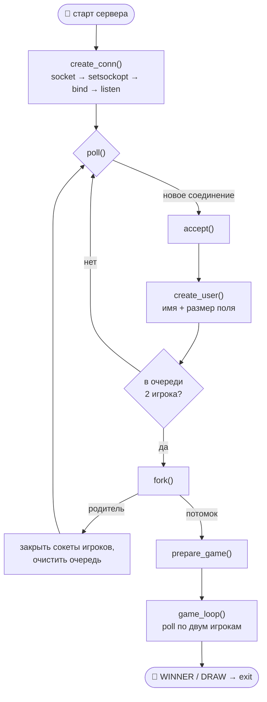
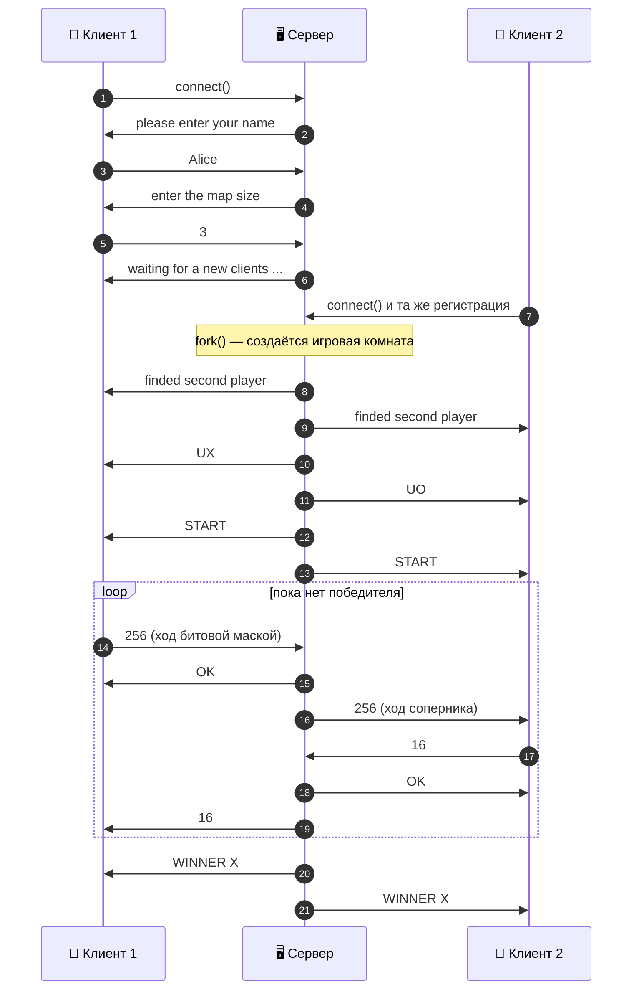

<div align="center">

# ❌ XO Game ⭕

### Сетевые крестики-нолики на чистом C

Клиент-серверная игра для двух игроков по **TCP**. Сервер сам подбирает пару<br>
и запускает для каждой партии отдельный процесс.


</div>

---

## 📑 Содержание

- [✨ Возможности](#-возможности)
- [🌐 Сетевые технологии](#-сетевые-технологии)
- [🏗 Архитектура сервера](#-архитектура-сервера)
- [📡 Протокол обмена](#-протокол-обмена)
- [🧠 Игровая логика: поле в битах](#-игровая-логика-поле-в-битах)
- [📂 Структура проекта](#-структура-проекта)
- [🚀 Сборка и запуск](#-сборка-и-запуск)
- [🎮 Как играть](#-как-играть)
- [🗺 Roadmap](#-roadmap)

---

## ✨ Возможности

| | |
|---|---|
| 🔌 **TCP-сервер** | принимает любое количество клиентов на порту `8080` |
| 🤝 **Подбор пары** | первые два зарегистрированных игрока попадают в одну комнату |
| 🍴 **Комната = процесс** | каждая партия идёт в своём процессе (`fork`), и партии не мешают друг другу |
| 📦 **Свой протокол** | сообщения с длиной впереди, поэтому TCP их не склеивает |
| ⚡ **Без потоков** | `poll()` следит за сокетами и `stdin` в одном цикле |
| 🧮 **Поле в битах** | ходы хранятся битовыми масками, проверка клетки — одна операция `&` |
| 🛡 **Проверки на сервере** | очерёдность хода и занятость клетки проверяет сервер |

---

## 🌐 Сетевые технологии

Всё построено на **BSD Sockets API** (POSIX), без сторонних библиотек.

### Что используется и где

| Технология | Где в коде | Зачем |
|---|---|---|
| `socket(AF_INET, SOCK_STREAM, 0)` | `conn/ConnHandler.c`, `client/client.c` | TCP-сокет поверх **IPv4** |
| `setsockopt(SO_REUSEADDR)` | `conn/ConnHandler.c` | сервер можно сразу перезапустить на том же порту, без ожидания `TIME_WAIT` |
| `bind()` + `INADDR_ANY` | `conn/ConnHandler.c` | принимать соединения на всех сетевых интерфейсах |
| `htons(PORT)` | сервер и клиент | перевод порта в **сетевой порядок байт** (big-endian) |
| `listen(fd, 5)` | `conn/ConnHandler.c` | очередь из 5 ещё не принятых соединений (backlog) |
| `accept()` | `main.c` | новый сокет для каждого клиента |
| `inet_pton()` + `connect()` | `client/client.c` | клиент подключается к `127.0.0.1:8080` |
| `poll()` | `main.c`, `event/EventLoops.c`, `client/client.c` | **I/O-мультиплексирование**: ждать сразу несколько fd |
| `POLLIN` / `POLLHUP` / `POLLERR` | там же | данные пришли / соединение закрыто / ошибка |
| `fork()` | `main.c` | модель **process-per-room**: своя игра в своём процессе |
| `send(..., MSG_NOSIGNAL)` | `send_msg()` | если клиент отключился, `send` вернёт ошибку и не убьёт процесс сигналом `SIGPIPE` |
| `recv(..., MSG_WAITALL)` | `recv_msg()` | ждать, пока не придёт **ровно** нужное число байт |
| Length-prefixed framing | `send_msg()` / `recv_msg()` | разделять сообщения в потоке TCP |

### 🔁 TCP — это поток, а не сообщения

У каждого сокета есть **буфер приёма**, и он работает как очередь (FIFO). Байты приходят в том порядке, в каком их отправили, но **границ между `send()` нет**:

```text
send("UX")     ──►  ┌─────────────────────────┐
send("START")  ──►  │ U X S T A R T           │  ──►  recv(fd, buf, 1024) = "UXSTART" 😱
                    └─────────────────────────┘
```

Поэтому каждое сообщение начинается с байта длины, и получатель точно знает, сколько читать:

```text
send_msg("UX")     ──►  ┌──────────────────────────────────┐
send_msg("START")  ──►  │ 02 U X 05 S T A R T              │
                        └──────────────────────────────────┘
                          │  └┬┘  │  └───┬───┘
                          │   │   │      └─ recv(5) → "START" ✅
                          │   │   └──────── recv(1) → длина 5
                          │   └──────────── recv(2) → "UX"    ✅
                          └──────────────── recv(1) → длина 2
```

### ⚡ `poll()`: одна нить следит за всем

- **Сервер (главный процесс)** следит за слушающим сокетом и сокетами ожидающих игроков.
- **Игровой процесс** следит за сокетами двух игроков.
- **Клиент** следит за сокетом сервера и `stdin`, поэтому может одновременно ждать ход соперника и ваш ввод.

---

## 🏗 Архитектура сервера



> 💡 После `fork()` у родителя и у потомка **одни и те же** открытые сокеты.
> Родитель закрывает свои копии сокетов игроков. Иначе соединение не закроется
> даже после того, как игровой процесс завершится.

---

## 📡 Протокол обмена

### Формат кадра

```text
┌──────────────┬───────────────────────────────┐
│   1 байт     │        N байт (0 … 255)       │
│  длина = N   │     текст сообщения, без \0   │
└──────────────┴───────────────────────────────┘
```

| Сообщение | Байты в сети |
|---|---|
| `"UX"` | `02 55 58` |
| `"START"` | `05 53 54 41 52 54` |
| `"256"` | `03 32 35 36` |

Длина хранится в `unsigned char`, поэтому одно сообщение — не больше **255 байт**.

### Ход партии



### Справочник сообщений

| Направление | Сообщение | Значение |
|---|---|---|
| 🖥 → 🧑 | `UX` / `UO` | «вы играете за X / за O» |
| 🖥 → 🧑 | `START` | игра началась, клиент переходит в режим ходов |
| 🧑 → 🖥 | `"<число>"` | ход: маска с одной единицей, например `256` |
| 🖥 → 🧑 | `OK` | ваш ход принят |
| 🖥 → 🧑 | `"<число>"` | ход соперника |
| 🖥 → 🧑 | `not your turn` | сейчас ход соперника |
| 🖥 → 🧑 | `not valid format` | пришло не число |
| 🖥 → 🧑 | `WARING …` | клетка уже занята |
| 🖥 → 🧑 | `WINNER X` / `WINNER O` | конец игры, есть победитель |
| 🖥 → 🧑 | `DRAW` | ничья |

### 🔮 Следующая версия: бинарный протокол

В `protocol/protocol.h` описан заголовок фиксированного размера, **6 байт**:

```c
typedef struct {
    uint8_t  type;      // тип сообщения: enum MsgType
    uint8_t  reserved;  // всегда 0
    uint16_t value;     // ход / размер поля / знак — в network byte order
    uint16_t len;       // длина текста после заголовка
} __attribute__((packed)) MsgHeader;
```

- `__attribute__((packed))` убирает выравнивание, и структура занимает ровно 6 байт.
- `uint16_t` передаются в сетевом порядке байт, поэтому их нужно переводить через `htons()` / `ntohs()`.
- Тип сообщения (`MSG_STEP`, `MSG_WIN`, `MSG_DRAW` …) — это число, а не строка, поэтому парсить текст не нужно.

---

## 🧠 Игровая логика: поле в битах

Каждая клетка — один бит числа. Клетка `(i, j)` поля `n × n` соответствует биту:

$$\text{bit}(i, j) = (n - 1 - i) \cdot n + (n - 1 - j)$$

Для поля 3 × 3:

```text
        столбец 1   столбец 2   столбец 3
строка 1   256         128          64
строка 2    32          16           8
строка 3     4           2           1
```

| Что | Как |
|---|---|
| ходы игрока | `user.step_set`: OR всех его ходов |
| всё поле | `map.map_set = X.step_set \| O.step_set` |
| клетка занята? | `map_set & step` |
| сделать ход | `step_set \|= step` |
| ход корректен? | в маске ровно **одна** единица |
| поле заполнено | `map_set == (1 << n*n) - 1` → для 3 × 3 это `511` |

**Пример.** Игрок вводит `2 2`, клиент переводит это в `16` (центр поля) и отправляет на сервер строку `"16"`.

**Победитель.** `check_winner_avilability()` проверяет `n` строк, `n` столбцов и 2 диагонали. Пустые клетки (`#`) не учитываются, поэтому функция работает для любого `n`.

---

## 📂 Структура проекта

```text
XO_game/
├── main.c                 🚪 точка входа сервера: accept, очередь, fork
├── AppModels.h            🧱 структуры User и Map
├── static.h               ⚙️  BUFFSIZE, PORT, SEND/RECV
│
├── conn/                  🌐 сетевой слой
│   ├── ConnHandler.c         create_conn, send_msg, recv_msg, обработка ошибок
│   └── conn_handler.h
│
├── event/                 🔄 события и игровой цикл
│   ├── EventLoops.c          create_user, broadcast_message, game_loop
│   ├── event_loops.h
│   ├── tools.c               find_usr_by_fd
│   └── tools.h
│
├── game/                  🎲 правила игры
│   ├── MapService.c          матрица, перевод маски в координаты, ход
│   ├── map_service.h
│   ├── MapHandler.c          занятость клетки, победитель, ничья
│   └── map_handler.h
│
├── protocol/              📦 бинарный протокол (в разработке)
│   ├── protocol.h
│   └── protocol.c
│
├── client/                🧑 консольный клиент
│   └── client.c
│
└── test/                  🧪 черновые тесты
    └── test.c
```

---

## 🚀 Сборка и запуск

**Нужно:** Linux (или другая POSIX-система) и `gcc`.

Сервер:

```bash
gcc main.c conn/ConnHandler.c event/EventLoops.c event/tools.c game/MapHandler.c game/MapService.c -o server
```

Клиент:

```bash
gcc client/client.c -o client/a.out
```

Запуск: сервер в одном терминале, клиенты в двух других.

```bash
./server
```

```bash
./client/a.out
```

---

## 🎮 Как играть

1. 🧑 Введите **имя**.
2. 📐 Введите **размер поля**: сейчас поддерживается только `3`.
3. ⏳ Подождите второго игрока. Когда он подключится, придёт `UX` или `UO` и затем `START`.
4. ❌ Первым ходит **X**. Ход вводится двумя числами `строка столбец` от 1 до 3:

   ```text
   2 2
   ```

5. 🏆 Кто первым соберёт линию, тот победил. Если поле заполнено и линии нет, это ничья.

```text
X O #
# X #      # — свободная клетка
O # X      ← X победил по диагонали
```

---

## 🗺 Roadmap

- [x] TCP-сервер на BSD sockets
- [x] Протокол с длиной сообщения впереди
- [x] Подбор пары и игровые комнаты через `fork()`
- [x] `poll()` на сервере и в клиенте
- [x] Проверка победителя для поля `n × n`
- [ ] Исправить раскладку маски по матрице (`merge_matrix_and_sets`)
- [ ] Определение ничьей через `(1 << n*n) - 1`
- [ ] Полная проверка хода на сервере: одна единица и в пределах поля
- [ ] Сообщить сопернику, если игрок отключился
- [ ] Регистрация игроков без блокировки главного цикла
- [ ] Перейти на бинарный протокол из `protocol/protocol.h`
- [ ] Поддержка полей больше 3 × 3
- [ ] IP-адрес сервера в аргументах клиента
- [ ] `Makefile`

---

<div align="center">

Сделано на C, сокетах и битовых масках ❤️

</div>
